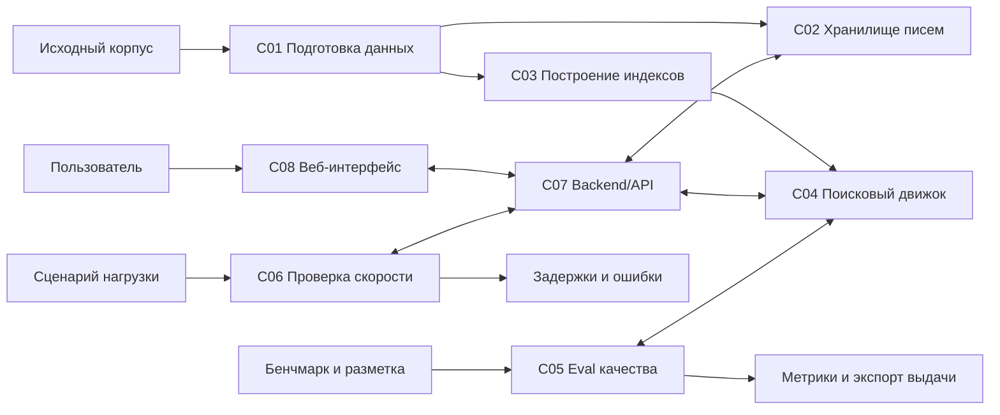

# Компоненты продукта «Умный поиск в Почте»

Требования и условия хакатона: [PROJECT.md](PROJECT.md). Обозначения R01–R08 и B01–B02 ссылаются на требования и бонусы из этого документа.

Описанная ниже архитектура — проектное решение команды. Компоненты являются логическими модулями приложения и инструментами для офлайн-запусков. Для хранилища писем выбран PostgreSQL (P07 в PROJECT.md). Остальные технологии, границы отдельных сервисов, модели, алгоритмы, HTTP-контракты и конкретные схемы данных на этом этапе не фиксируются.

## 1. Состав продукта

| ID | Компонент | Ответственность |
| --- | --- | --- |
| C01 | Подготовка данных | Прочитать корпус, проверить данные и идентификаторы, получить единое представление писем. |
| C02 | Хранилище писем | Предоставлять ящики, списки писем, метаданные и содержимое для просмотра. |
| C03 | Построение индексов | Заранее подготовить поисковые структуры и сохранить параметры их построения. |
| C04 | Поисковый движок | Обработать запрос, отобрать и ранжировать письма; при необходимости выполнить reranking. |
| C05 | Eval качества | Запустить бенчмарк, вычислить метрики, сохранить выдачу и сравнить варианты поиска. |
| C06 | Проверка скорости | Создать заданную нагрузку и проверить время выполнения серверного поиска. |
| C07 | Backend/API | Предоставлять интерфейсу операции просмотра и поиска, связывая их с движком и хранилищем. |
| C08 | Веб-интерфейс | Обеспечить выбор ящика, просмотр писем, поиск и чтение результатов. |
| C09 | Запуск и воспроизводимость | Описать и воспроизвести подготовку данных, индексацию, запуск приложения и проверок. |

## 2. Границы, зависимости и критерии готовности

### C01. Подготовка данных

- **Вход:** исходный архив писем и описание его фактического формата.
- **Выход:** подготовленный корпус, связь с оригиналами и ящиками, отчёт о количестве записей и найденных проблемах.
- **Граница:** чтение, проверка и нормализация данных; построение поисковых индексов относится к C03. Представление для поиска сохраняет связь с исходным содержимым для просмотра.
- **Зависимости:** предоставленный корпус; правила интерпретации его полей устанавливаются после изучения данных.
- **Готовность:** корректные письма читаются; официальные идентификаторы сохраняются; область их уникальности проверена; повреждённые записи, дубликаты и пропуски отражены в отчёте. Число писем и ящиков сопоставлено с фактическим архивом, а не жёстко ограничено приблизительными числами из презентации.

### C02. Хранилище писем

- **Технология:** PostgreSQL для писем, ящиков и метаданных. Хранение поисковых индексов и векторов определяется отдельно в C03.
- **Вход:** подготовленный корпус; запрос списка ящиков, писем выбранного ящика или конкретного письма.
- **Выход:** список ящиков, список писем с доступными метаданными, содержимое письма либо результат «не найдено».
- **Граница:** доступ к данным для просмотра; релевантность и порядок поисковой выдачи определяет C04.
- **Зависимости:** C01.
- **Готовность:** доступные письма можно перечислить и открыть по идентификатору; неизвестное письмо обрабатывается явно; запрос в контексте одного ящика не раскрывает письма другого.

### C03. Построение индексов

- **Вход:** подготовленный корпус и конфигурация индексации.
- **Выход:** поисковые структуры, версия индексов и сведения о корпусе и параметрах построения.
- **Граница:** подготовка поисковых структур до запуска пользовательских запросов. Способ индексации и число индексов выбираются позже.
- **Зависимости:** C01; общий с C04 способ загрузки подготовленных индексов.
- **Готовность:** индексы строятся и повторно загружаются из сохранённых артефактов; сохраняется соответствие документов исходным идентификаторам и ящикам; несовместимые версии корпуса и индексов обнаруживаются при запуске.

### C04. Поисковый движок

- **Вход:** текст запроса, контекст выбранного ящика, глубина выдачи K, загруженные индексы и конфигурация поиска.
- **Выход:** упорядоченный список `doc_id`; при необходимости — оценки и сведения для диагностики. Получение содержимого найденных писем выполняет C02.
- **Граница:** подготовка запроса, отбор кандидатов и ранжирование. Reranking добавляется при подтверждённой пользе. Одна реализация поиска вызывается из приложения, eval и проверки скорости.
- **Зависимости:** C03 и доступ к требуемым поиску представлениям подготовленных документов.
- **Готовность:** возвращаются существующие документы из выбранного ящика без повторов; порядок сохраняется при передаче в API и экспорт; отсутствие совпадений даёт пустую выдачу. Качество и задержки измеряются через C05 и C06, а параметры используемых моделей проверяются относительно R08.

### C05. Eval качества

- **Вход:** запросы бенчмарка, контекст ящиков, разметка релевантности, значения K, параметры расчёта метрик и конфигурация движка.
- **Выход:** ранжированная выдача для каждого `query_id`, Recall@K/nDCG@K/MRR@K, результаты по запросам, агрегированный отчёт и сравнение запусков.
- **Граница:** оценка качества и экспорт для проверки. Генерация нагрузки и проверка p99 относятся к C06. Формат организаторов подключается через адаптер после получения протокола; внутренняя поисковая логика остаётся общей.
- **Зависимости:** C04, бенчмарк и разметка; C09 для идентификации и воспроизведения запусков.
- **Готовность:** каждый запрос из входного набора отражён в результате; выдача сохраняется без изменения ранжирования; метрики проверены на небольшом примере с заранее известными ответами. Для отчёта указаны версия корпуса и индексов, версия кода, параметры метрик и поиска. Без официальных весов отчёт содержит отдельные метрики, а не выдуманный итоговый балл.

### C06. Проверка скорости

- **Вход:** запущенный серверный поиск, набор запросов и описание нагрузки: параллелизм, длительность или число запросов, условия прогрева и кеширования.
- **Выход:** число запросов и ошибок, таймауты, серверные p50/p95/p99, проверка условия `p99 < 1 с`, описание окружения и конфигурации.
- **Граница:** измерение от получения запроса сервером до готовой поисковой выдачи, включая обработку запроса, поиск и ранжирование. Клиентское время запроса можно собирать дополнительно, но оно не заменяет серверный замер R07.
- **Зависимости:** C04, минимальный серверный вход C07 и средства фиксации запусков C09.
- **Готовность:** сценарий воспроизводится; границы серверного замера определены; ошибки и таймауты видны в отчёте. Указаны оборудование, объём данных, число запросов, нагрузка, правила кеша и прогрева. Локальное выполнение порога относится только к описанному сценарию и не объявляется результатом приватной проверки.

### C07. Backend/API

- **Вход:** операции выбора ящика, получения списка писем, чтения письма и поиска с текстом запроса и контекстом ящика.
- **Выход:** данные для интерфейса, поисковая выдача в порядке движка и понятные результаты обработки ошибок.
- **Граница:** проверка входных данных и связывание интерфейса с C02 и C04. Поисковый алгоритм находится в C04. Конкретные маршруты, методы HTTP и форматы сообщений выбираются позже.
- **Зависимости:** C02 и C04; серверные точки измерения для C06.
- **Готовность:** операции вызываются из интерфейса; пустой запрос обрабатывается как ошибка валидации; неизвестные ящик или письмо обрабатываются явно; выдача ограничена выбранным ящиком и сохраняет порядок C04. Сбой индекса или движка отличается от корректной пустой выдачи.

### C08. Веб-интерфейс

- **Вход:** действия пользователя и ответы C07.
- **Выход:** выбранный ящик, список писем, запрос поиска, ранжированные результаты и открытое письмо.
- **Граница:** пользовательское взаимодействие и отображение. Интерфейс отображает порядок, полученный от API.
- **Зависимости:** C07.
- **Готовность:** основной сценарий из PROJECT.md проходит целиком; предусмотрены состояния загрузки, пустого ящика, отсутствия результатов, ошибки и недоступного письма. При смене ящика прежняя выдача не отображается как результат нового ящика; устаревший ответ не подменяет результаты более нового запроса.

### C09. Запуск и воспроизводимость

- **Вход:** исходный код, данные, конфигурация и зависимости выбранного стека.
- **Выход:** инструкция подготовки и запуска, конфигурации экспериментов, сохранённые индексы, выдача и отчёты с идентифицируемыми версиями.
- **Граница:** воспроизводимый жизненный цикл приложения и экспериментов; конкретные способы установки, запуска и размещения выбираются вместе со стеком.
- **Зависимости:** все компоненты; минимальные инструкции и фиксация параметров появляются с первых экспериментов.
- **Готовность:** участник команды запускает подготовку корпуса, индексацию, приложение, eval и проверку скорости по README; отчёт можно связать с кодом, данными, индексами и настройками. Локальная демонстрация готова; для бонуса B01 отдельно проверена публичная ссылка.

## 3. Потоки данных и вызовов

Основные потоки:

1. **Подготовка:** исходный корпус → C01 → C02 и C03 → готовые для C04 индексы. Сохраняются связь с оригиналами, принадлежность ящикам и версии артефактов.
2. **Пользовательский поиск:** пользователь → C08 → C07 → C04 → упорядоченные идентификаторы → C02 для данных результатов → C07 → C08. Открытие письма проходит через C07 и C02 с проверкой выбранного ящика.
3. **Оценка качества:** бенчмарк → C05 → тот же C04 → выдача → метрики и экспорт. Контекст ящика берётся из бенчмарка по его фактическому протоколу.
4. **Проверка скорости:** сценарий нагрузки → C06 → серверный поиск C07/C04 → серверные замеры → отчёт. Время сети и отрисовки не подмешивается в p99 поиска.

C09 поддерживает все потоки: фиксирует настройки, версии и порядок запуска.

## 4. Порядок разработки

| Этап | Работа | Проверяемый результат |
| --- | --- | --- |
| 1. Данные и минимальный поиск | Изучить реальный корпус; реализовать C01, минимальный C02, C03 и C04. Зафиксировать первые инструкции C09. | Письма доступны по исходным идентификаторам; запрос возвращает ранжированные документы выбранного ящика, найденное письмо открывается через хранилище. |
| 2. Eval качества | Реализовать C05, загрузку публичных запросов и разметки, расчёт метрик и сохранение выдачи. После получения протокола добавить официальный экспорт. | Есть воспроизводимый исходный результат, отчёт по запросам и проверяемое соответствие `query_id` → ранжированные `doc_id`. |
| 3. Улучшение поиска и проверка скорости | Добавить минимальный серверный вход C07 и C06; сравнивать варианты C03/C04 по качеству и времени. | Для вариантов сохранены конфигурации и сопоставимые отчёты; выбран вариант с учётом качества, p99 и условий R08. |
| 4. Веб-продукт | Довести C02 и C07 до полного набора операций; реализовать C08. | Пользователь выбирает ящик, просматривает письма, ищет своими словами и читает найденное письмо. |
| 5. Подготовка сдачи | Завершить C09, проверить README и сценарий защиты; подготовить экспорт. Для B01 развернуть публичное демо. | Приложение и проверки запускаются по инструкции; демонстрация проходит; результаты связаны с версиями кода и данных. |
| 6. Бонусные функции | После готовности основной задачи выбрать полезный почтовый сценарий с учётом уточнённых правил B02. | Дополнительная функция решает понятную задачу и демонстрируется на защите. |

При смене алгоритма, индексов или конфигурации после этапа 3 повторяются связанные проверки качества и скорости. Основной набор пользовательских сценариев проверяется после сборки приложения и перед сдачей.

## 5. Связь требований с компонентами и проверками

| Требование или условие | Компоненты | Способ проверки |
| --- | --- | --- |
| R01: поиск по смыслу | C01, C03, C04, C05 | Запуск публичного бенчмарка; разбор запросов с отличающимися формулировками; сохранение выдачи и метрик. |
| R02: просмотр, поиск и чтение писем | C02, C07, C08 | Сквозной пользовательский сценарий в браузере. |
| R03: код и инструкция запуска | C09 | Независимый запуск участником команды по README. |
| R04: работающая демонстрация и защита | C07, C08, C09 | Репетиция поиска и открытия письма; объяснение устройства и измеренных результатов. |
| R05: ранжированные `doc_id` для `query_id` | C04, C05 | Полнота запросов экспорта, существование идентификаторов, отсутствие повторов и сохранение порядка движка. |
| R06: Recall@K, nDCG@K, MRR@K | C05 | Пример с заранее известными ответами; запуск с явно указанными K и правилами расчёта, сверка с протоколом организаторов после его получения. |
| R07: p99 < 1 с | C04, C06, C07 | Серверные замеры под описанной нагрузкой; фиксация p99, ошибок, прогрева и кеширования. |
| R08: условия использования моделей | C03, C04, C09 | Перечень моделей, размеров и этапов применения; проверка наличия API-вызовов; документирование возможного штрафа. |
| Предоставленный корпус и разделение на ящики | C01, C02, C03, C04 | Отчёт импорта, сохранность официальных идентификаторов, проверки изоляции ящиков. |
| Публичный и приватный бенчмарки | C05, C09 | Локальная оценка по публичным данным; воспроизводимый запуск и адаптация к официальному формату без отдельной поисковой логики для приватной проверки. |
| B01: +1 балл за публичное демо | C07, C08, C09 | Проверка доступности публичной ссылки и основного сценария из внешнего браузера. |
| B02: необязательные почтовые функции | По выбранной функции | Отдельный сценарий и критерий готовности после уточнения правил бонуса. |

## 6. План проверок и особые случаи

Это проверки реализации и будущих компонент, а не уже выполненные тесты продукта.

| Сценарий | Ожидаемое поведение |
| --- | --- |
| Пустой запрос или только пробелы | API возвращает понятную ошибку валидации; интерфейс предлагает ввести запрос; поиск не запускается. |
| Нет результатов | Корректная пустая выдача; интерфейс показывает отсутствие результатов. |
| Неизвестный идентификатор письма | Понятный результат «не найдено»; другое письмо не подставляется. |
| Неизвестный ящик | Явная ошибка; переход к поиску по всем ящикам не выполняется. |
| Документ принадлежит другому ящику | Поиск, список и открытие письма не раскрывают его в текущем контексте. |
| Одинаковые локальные идентификаторы в разных ящиках | Привязка к исходному ящику сохраняется; формат официальных идентификаторов учитывается после изучения корпуса. |
| Документов меньше K | Возвращаются доступные результаты без повторов и искусственного заполнения выдачи. |
| Смена ящика или новый запрос во время загрузки | Прежние результаты и запоздавшие ответы не подменяют актуальное состояние интерфейса. |
| Индексы отсутствуют или не соответствуют корпусу | Ошибка обнаруживается при подготовке или запуске и не маскируется под отсутствие результатов. |
| Один запрос через движок, eval и API | При одинаковых версиях, контексте и параметрах сохраняется одинаковый порядок документов. |
| Экспорт бенчмарка | Для каждого входного `query_id` есть запись; каждый `doc_id` существует и относится к нужному контексту; ранжирование сохраняется. |
| Метрики на контрольном примере | Совпадают с заранее рассчитанными результатами по явно выбранным правилам. Спорные случаи разметки согласуются с официальным протоколом. |
| Замер задержки | В серверный замер включены все этапы запроса до готовой выдачи; отдельно учтены ошибки и таймауты; параметры нагрузки воспроизводимы. |
| Повторный запуск по инструкции | На том же корпусе и конфигурации загружаются нужные артефакты, выполняются приложение и eval, сохраняется отчёт. |

Окончательная сверка метрик, экспорта и нагрузочного сценария выполняется после получения официального протокола. Открытые вопросы перечислены в [PROJECT.md](PROJECT.md).
